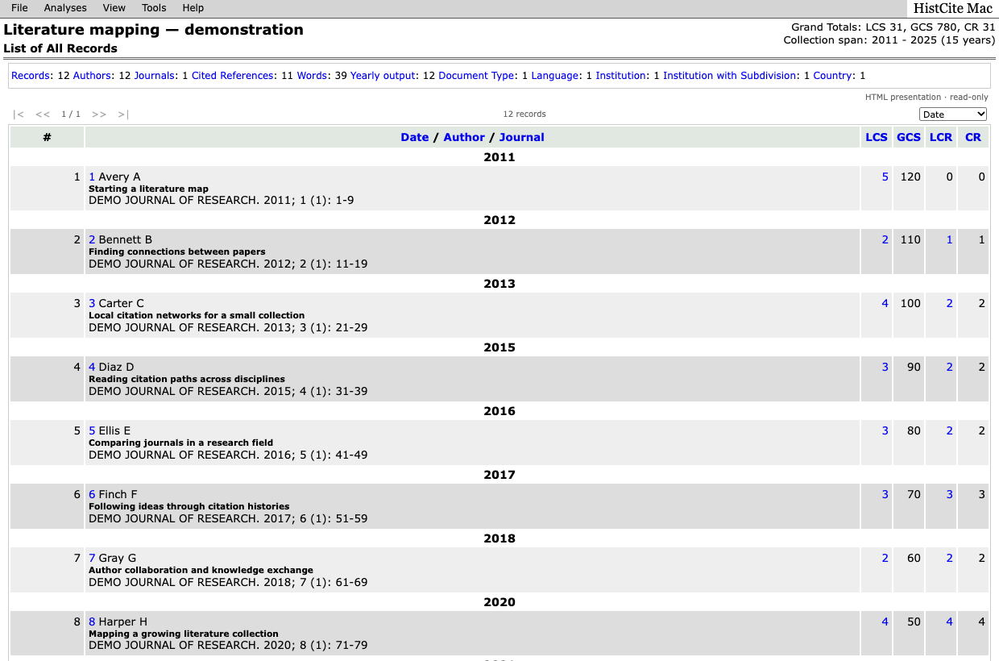
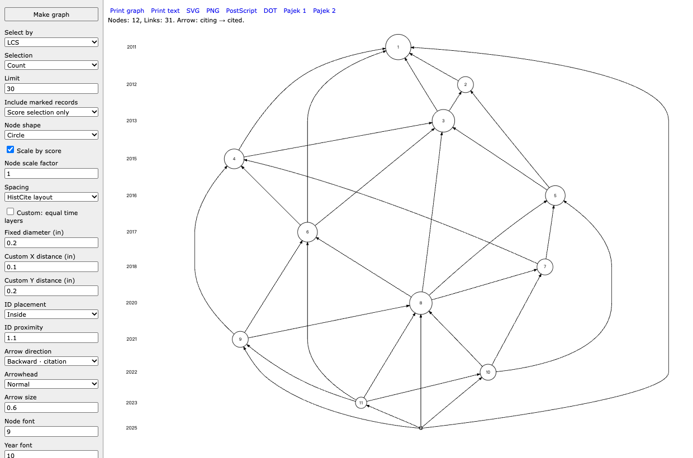

# HistCite Mac

**An independent macOS project by `yangnim21029`, not an official HistCite release.** The original HistCite was developed by Eugene Garfield and collaborators; this project is not affiliated with that team. [Project identity and attribution](docs/project-identity.md).

**HistCite Mac is a free, native macOS app for Web of Science citation analysis and visualization.**

After a Web of Science (WoS) search returns hundreds or thousands of records, citation relationships offer a useful starting point for reading. Which papers are frequently cited within the collection? How do later studies build on earlier work? Which authors, journals or topics deserve a closer look?

HistCite Mac is an independently developed macOS bibliometric tool with a Rust analysis core. It follows the main workflows of HistCite 12.03.17, helping researchers organize literature, compare citation indicators and use Graph Maker to visualize connections between papers.

**Importing, organizing and analyzing your collection all happen locally on your Mac. No Windows, Wine or programming environment is needed.**

[**Download HistCite Mac**](https://github.com/yangnim21029/histcite-mac/releases/latest) · [Project website](https://yangnim21029.github.io/histcite-mac/) · [Watch the demo](#watch-histcite-mac-in-60-seconds) · [繁體中文](README.zh-TW.md) · [简体中文安装指南](docs/mac-install.zh-CN.md) · [Release history](https://github.com/yangnim21029/histcite-mac/releases)

macOS 13 Ventura or later · Apple Silicon and Intel Macs · Free and open source

- **Using HistCite Mac for research?** Follow the [citation analysis tutorial](docs/citation-analysis.md) to trace a reference and draw a citation graph. The tutorial also links to the research behind HistCite.
- **Interested in the implementation?** Read [how a reference becomes a citation link](docs/citation-matching.md), or start with the [developer guide](docs/development.md) to build, test or contribute.

 

These badges show automated check results and repository practices. See the [review scope and known limitations](docs/security-review.md), including the legacy Graphviz engine; they are not security certification.

## Community mentions

Thank you to [jaywcjlove](https://x.com/jaywcjlove/status/2121782872545837467) for including HistCite Mac in Awesome Mac and sharing the demo.

Thanks also to [RefTools](https://github.com/specter119/RefTools/blob/master/histcite/README.md) and [Awesome Scholarly Data Analysis](https://github.com/napsternxg/awesome-scholarly-data-analysis#readme) for listing the project, and to [绿软下载](https://lvruan.com/app/6675) and [小狼成长实验室](https://ddw2019.com/153/#i-32) for introducing it to their readers.

## Watch HistCite Mac in 60 seconds

See a native macOS demonstration of importing a WoS plain-text file, sorting by LCS and GCS, browsing authors, viewing a Historiograph and opening a record's details. The video uses 12 fictional records with 31 local citation links and includes English captions.

The video demonstrates the interface, not compatibility with every current WoS export. See the [direct-import check and its limits](docs/compatibility.md#direct-import-check) for a separate check using two original research exports without external cleaning.

https://github.com/user-attachments/assets/0c809917-e373-4628-b55f-fc354c1838c0

[Download the MP4](https://github.com/yangnim21029/histcite-mac/releases/download/v0.3.4/HistCite-Mac-demo-en.mp4) · [English subtitles (SRT)](https://github.com/yangnim21029/histcite-mac/releases/download/v0.3.4/HistCite-Mac-demo-en.srt)

HistCite Mac is an independent implementation by yangnim21029. Credit for the original HistCite belongs to Eugene Garfield and collaborators; this is not an official release from the original authors.

## Start in three steps

### 1. Download and install

Download the **Universal DMG** from the [latest release](https://github.com/yangnim21029/histcite-mac/releases/latest). The same file works on both Apple Silicon and Intel Macs.

Open the DMG and drag **HistCite Mac** into **Applications**, then open the app from there.

> **First launch:** this community release is not Apple-notarized. If macOS blocks it, confirm that you downloaded it from this project's release page, then use **System Settings → Privacy & Security → Open Anyway**. This creates an exception for this app; it does not mean Apple has verified its safety. [Apple's instructions](https://support.apple.com/en-us/102445).

### 2. Prepare your Web of Science records

After searching Web of Science, export your records using:

- **File format:** Plain Text
- **Record content:** Full Record and Cited References

HistCite Mac reads the exported `.txt` files directly. If you exported records in several batches, you can select multiple files together.

**Keep the original exports and your search criteria.** They let you check the source, scope and processing decisions behind an analysis later.

### 3. Import your collection and start exploring

Open HistCite Mac and choose **File → Open collection…** to load your files. Three actions provide a useful first look:

1. **Browse the literature list.** Click **LCS** to sort papers by the citations they receive within the current collection.
2. **Open a paper's details.** Read its abstract, references and bibliographic information in a separate window.
3. **Draw a citation map.** Choose **Tools → Graph Maker…** to see how papers in the collection connect through citations.

**Try the sample collection:** the DMG includes `demo-wos.txt`, with 12 fictional papers. Copy it to your Mac and import it to explore the tables, citation indicators and Graph Maker before using your own research data.

## What can you do?

### 1. Use citation indicators to guide further reading

When a search produces a large collection, citation indicators can help identify papers to examine first. HistCite Mac pairs these indicators with paper details so that you can move from a count to the underlying research.

Two commonly used indicators describe different citation scopes:

- **LCS (Local Citation Score):** the number of citations a paper receives from other records in the currently imported collection.
- **GCS (Global Citation Score):** the citation count recorded by WoS at the time of export. It does not update automatically after import.

A paper may have a high GCS but a modest LCS. It may be widely cited in the source database while receiving fewer citations within the particular collection you assembled. Comparing the two helps distinguish those contexts when deciding what to read next.

### 2. Examine the composition of your collection

Group records by bibliographic fields to explore how the literature is distributed. Available analyses include:

- Authors and journals
- Cited references
- Words and publication years
- Document types and languages
- Institutions, subdivisions and countries

For example, yearly output shows changes in the number of publications over time. Author and journal lists help identify researchers and publication venues that appear frequently in your collection.

These views provide several ways into the same set of records, making it easier to move between an overview and the papers behind it.

### 3. Follow citation relationships with Graph Maker

A citation count tells you how often a paper is cited. Graph Maker shows which papers connect to it and where those connections fall over time.

Use the graph to investigate which earlier studies are cited by later work, or follow a citation path through several papers. You can:

- Adjust timeline options and node sizing.
- Set arrow direction and labels.
- Merge shared sections of citation links.
- Hover over a node to see its citation information.
- Click a node to open the paper's details.

This makes relationships recorded across many reference lists easier to inspect and follow back to individual papers.

### 4. Organize, correct and merge bibliographic records

Bibliometric work also involves checking duplicate records, missing information and inconsistent names. Search, marks, tags and record editing help you organize the collection and define the records relevant to your research question. Collection changes support undo.

**Duplicate rules are applied automatically when importing TXT/HCI records and when adding files.** The default follows the observed HistCite bibliographic rules, which can merge records even when their identifiers differ. Review the merge history in **Tools → Data checks** and retain your original exports so that you can compare titles, authors, publication details and identifiers.

Existing `.hcm` collections are reopened as saved. To consolidate them explicitly, use **Tools → Merge duplicates**; that operation can be undone. The merge history retains incoming record fields for later inspection.

### 5. Save your work and export results

Choose a format according to what you want to do next:

| Format | Main use |
| --- | --- |
| `.hcm` | Save a HistCite Mac working collection for further editing and analysis |
| `.hci` | Exchange records in HistCite collection format |
| CSV | Use bibliographic and metric data in a spreadsheet or another tool |
| Offline HTML | Share an interactive presentation that opens in a browser |
| SVG, PNG | Put citation graphs into reports, presentations or other documents |
| PostScript, DOT, Pajek | Continue working with graphics or network-analysis tools |

Use `.hcm` for ongoing work: it keeps records, tags, settings and saved graphs together. Data and graph exports support subsequent analysis, sharing and presentation.

### Interpreting the results

All views describe the collection you imported. Search criteria, database coverage, inclusion decisions and missing reference information affect both the counts and the graph. Citation counts also depend on publication age and document type.

**Use the results to identify questions and reading paths, then examine the papers and their context.** A citation connection alone does not establish a paper's contribution or explain why another study cites it.

## Frequently asked questions

### Is there a Mac version of HistCite?

**HistCite Mac is available as an independent macOS app.** It follows HistCite 12.03.17 workflows and provides local citation analysis and Graph Maker on macOS 13 or later, with one Universal DMG for Apple Silicon and Intel Macs. It does not require Windows, Wine, CrossOver or a virtual machine.

Older guides may describe the original Windows application or HistCite Pro. This project is a separate implementation, not an official macOS release from the original HistCite authors. [Download the Mac app](https://github.com/yangnim21029/histcite-mac/releases/latest) and follow the [installation steps](#start-in-three-steps), including the first-launch instructions for this unnotarized community build.

### Which input formats are supported?

You can directly open:

- **Web of Science tagged plain-text files** (`.txt`)
- **HistCite collections** (`.hci`)
- **HistCite Mac working collections** (`.hcm`)

Native Scopus exports and general Excel files require conversion to a compatible WoS tagged format first. If the records are available in WoS, you can also export them using the settings above.

Changing a file's extension to `.txt` does not convert its fields or internal structure.

### Is my literature collection uploaded to a server?

Importing, organizing and analyzing records happens locally. HistCite Mac does not upload your collection to a remote service.

If you choose a DOI or WoS link, the app opens the corresponding website in your browser. Your original import files are preserved; edits are made to the working collection.

### Can I continue my analysis later?

Yes. Choose **File → Save as…** and save an `.hcm` file to retain records, tags, settings and saved graphs. The app also restores your last working collection on launch.

For work that involves several rounds of cleaning or revision, save collections at useful milestones and keep the original exports so that you can compare stages of the analysis.

### Is HistCite Mac the original HistCite?

HistCite Mac is an independent Rust implementation following HistCite 12.03.17 workflows. It does not contain the original HistCite program code or executable, and it is not affiliated with the original authors.

Development has included comparisons of citation scores, analytical groups, duplicate merging and graph layout against the original on specific datasets and operation sequences. These checks establish compatibility within their tested scope; they do not prove that every input and feature behaves identically.

See [compatibility and validation](docs/compatibility.md) for the comparisons and known limits.

## Report a problem or contribute

If you encounter an error during import, record editing or graph analysis, please [open a GitHub issue](https://github.com/yangnim21029/histcite-mac/issues). Useful details include:

- Your macOS version and Mac chip type
- The input file format and app version
- The steps leading up to the problem
- The error message or a screenshot
- A small example that reproduces the problem

If an error occurs only with a particular collection, try reducing it to a few records that still trigger the issue. Remove private information and research data that should not be public before attaching files. A fictional example is particularly useful for discussion and testing.

For source code, tests and build instructions, see the [developer guide](docs/development.md).

**To use the app, simply download the Mac release. You do not need to compile it yourself.**

## License and third-party components

HistCite Mac's original code is [MIT licensed](LICENSE). Bundled components retain their own licenses, including:

- **Graphviz 2.2.1:** CPL 1.0
- **The sorting adapter:** BSD-3-Clause

Third-party notices and complete Graphviz source are included in the app. You can also read the [Graphviz and sorting notices](ui/THIRD-PARTY.txt) and [Rust dependency notices](licenses/Rust-dependencies.txt) in this repository.

[**Download HistCite Mac and explore your literature collection**](https://github.com/yangnim21029/histcite-mac/releases/latest)
