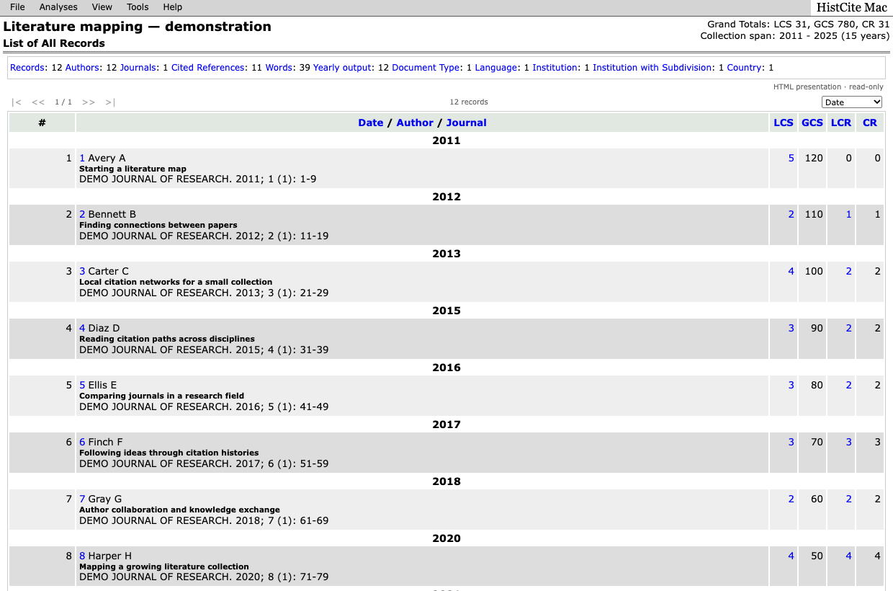
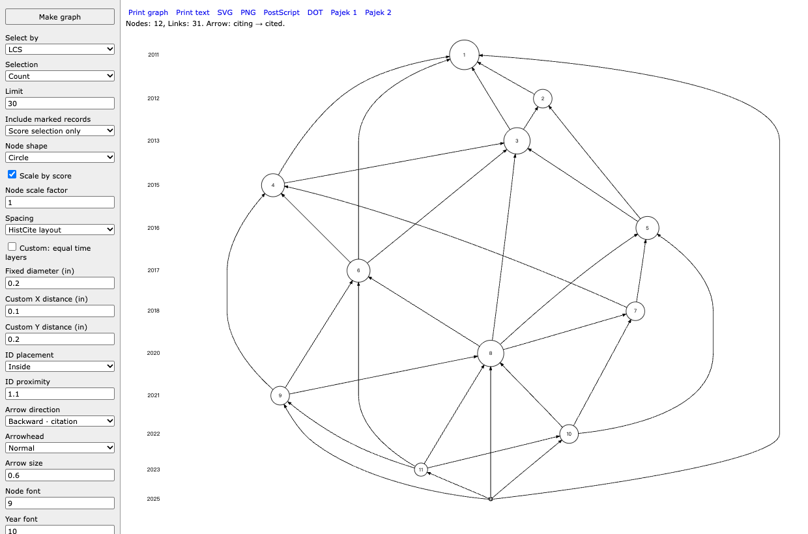

# HistCite Mac

**在 Mac 上整理文獻、追蹤引用，畫出研究發展脈絡。**

HistCite Mac 保留熟悉的 HistCite 文獻列表、書目計量分析與 Graph Maker 操作。匯入 Web of Science 資料即可開始，分析都在自己的 Mac 上完成。

**[下載 Mac 版](https://github.com/yangnim21029/histcite-mac/releases/latest/download/HistCite-Mac-0.3.2-universal.dmg)** · [English](README.md) · [版本紀錄](https://github.com/yangnim21029/histcite-mac/releases)

macOS 13 Ventura 以上 · 支援 Apple Silicon 與 Intel · 免費開源

## 三步開始

1. **下載並開啟 DMG**，把 **HistCite Mac** 拖進 **Applications（應用程式）**。
2. **開啟 HistCite Mac**，選 **File → Open collection…**，載入 WoS 匯出的 `.txt`。可一次選取多個檔案。
3. **開始探索**：點 **LCS** 依集合內引用次數排序、開啟文獻詳情，或選 **Tools → Graph Maker…** 繪製引用圖。

從 Web of Science 匯出時，選 **Plain Text（純文字）**與 **Full Record and Cited References（完整紀錄與引用的參考文獻）**。下載的 App 可直接使用，不需要終端機、Rust、Python、Windows 或 Wine。

想先試操作？DMG 內附 **demo-wos.txt** 虛構文獻集，複製到自己的 Mac 後，就能直接匯入。

> **第一次開啟：**這個社群版本尚未經 Apple 公證。如果 macOS 阻擋開啟，請到 **系統設定 → 隱私權與安全性 → 強制打開（Open Anyway）**，再開啟 HistCite Mac。這是針對此 App 的一次性確認。[Apple 操作說明](https://support.apple.com/zh-tw/102445)。

## 可以做什麼

- **研讀文獻**：獨立詳情視窗、摘要、參考文獻、相關記錄與引用分數。
- **書目計量**：作者、期刊、被引參考文獻、詞彙、年份、文獻類型、語言、機構、部門與國家分析。
- **整理集合**：搜尋、標記、標籤、編輯、合併重複資料，支援復原與合併紀錄。
- **引用圖**：時間軸、節點大小、箭頭方向、標籤與合併連線；移入節點看提示，點擊開啟文獻。
- **儲存分享**：`.hcm` 工作集合、HistCite `.hci`、CSV、離線 HTML，以及 SVG、PNG、PostScript、DOT、Pajek 圖形匯出。

## 常見問題

**資料會上傳嗎？** 不會。文獻分析在本機完成；只有主動點選 DOI 或 WoS 連結時才會開啟瀏覽器。匯入的來源檔會保留，工作進度可用 **File → Save as…** 另存成 `.hcm`。

**支援哪些輸入格式？** WoS 標籤式純文字 `.txt`、HistCite `.hci`、HistCite Mac `.hcm`。Excel 或 Scopus 匯出檔需先轉成相容的標籤格式，或從 WoS 重新匯出上述格式。

**下次能繼續嗎？** 可以。`.hcm` 會保存文獻、標籤、設定與已儲存的引用圖；App 也會自動恢復上次的工作集合。

**這是原版 HistCite 嗎？** 這是以 Rust 獨立實作、沿用 HistCite 12.03.17 工作方式的專案，與原作者沒有隸屬關係。引用分數、分析群組、合併規則與圖形排版已做原版對照；驗證範圍見[相容性說明](docs/compatibility.md)。

## 回報與參與

歡迎[回報問題或提出建議](https://github.com/yangnim21029/histcite-mac/issues)，請附 macOS 版本與重現步驟。範例檔以少量虛構資料為佳，附件請先移除私人資料。

想參與開發，可看[開發說明](docs/development.md)。一般使用直接下載 App 即可。

## 授權

本專案原創程式碼採 [MIT 授權](LICENSE)。隨附的 Graphviz 2.2.1 保留 **CPL 1.0**，排序程式保留 **BSD-3-Clause**；第三方聲明與完整 Graphviz 原始碼已隨 App 提供，也可在[倉庫中取得](ui/THIRD-PARTY.txt)。
