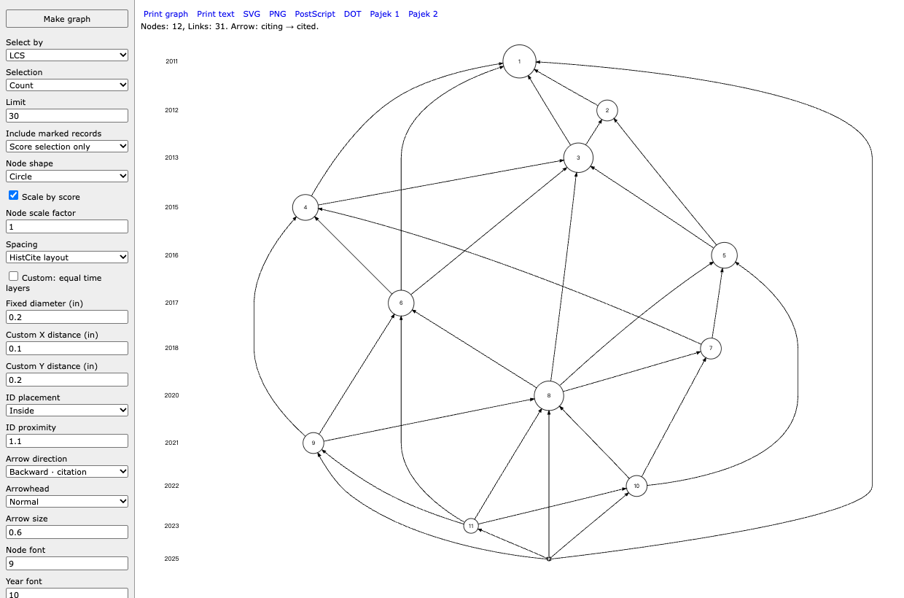

# Your first citation analysis with HistCite Mac

[繁體中文](citation-analysis.zh-TW.md)

Start with a small collection, check which papers cite a particular record, then draw a graph of those relationships. The lesson uses **12 fictional records** and the English menus in HistCite Mac v0.3.4. You can complete it without a Web of Science account.

## Open the sample collection

Install the app using the [Mac installation instructions](../README.md#1-download-and-install). Copy `demo-wos.txt` from the disk image, or [download the same sample](https://github.com/yangnim21029/histcite-mac/releases/download/v0.3.4/demo-wos.txt). In HistCite Mac, choose **File → Open collection…** and select the file. The collection shows **12 records and 31 citation links**.

## Trace a citation back to its source

1. Click the **LCS** column to sort by citations received within the collection. Find *Starting a literature map* (Avery, 2011). Its **LCS is 5** and its **GCS is 120**. Five records in this collection cite Avery. The sample's GCS is a simulated database count, which represents a separate scope.
2. Click the record number beside Avery's title to open its details. Under **Citing records**, find *Finding connections between papers* (Bennett, 2012).
3. Expand **Match evidence** beneath Bennett's entry. You should see `histcite_key: Avery A, 2011, DEMO J RES, V1, P1`. This line shows the matching method and the reference text imported with Bennett's record.

## Draw the citation graph

Return to the main window and choose **Tools → Graph Maker…**. The graph opens with the sample records arranged by publication year. Hover over a node to read its details, or click it to open the record. Look for Avery and Bennett at the early end of the timeline. Use **SVG** in the graph window if you want to save the figure.

## Continue with your own search

Export your Web of Science results as **Plain Text** with **Full Record and Cited References**. Keep the original files and record your search terms, database selection, export date and app version. Use **Tools → Data checks** to review import warnings and record merges before interpreting the graph. LCS depends on the records you include, while GCS reflects the count in the original export. Read the linked papers to understand why one work cites another.

## Research and further reading

- Eugene Garfield's 2004 paper describes how the original HistCite used Web of Science exports to map literature in chronological order. [Historiographic Mapping of Knowledge Domains Literature](https://journals.sagepub.com/doi/10.1177/0165551504042802).
- The University of Pennsylvania archive collects papers about the original HistCite and related applications. [Papers on Algorithmic Historiography](https://garfield.library.upenn.edu/algorithmichistoriographyhistcite.html).
- For the independent Mac implementation, see [verification results and compatibility limits](compatibility.md) and [how citation matching works](citation-matching.md). HistCite Mac is developed by `yangnim21029` and follows workflows from the original HistCite by Eugene Garfield and collaborators.
