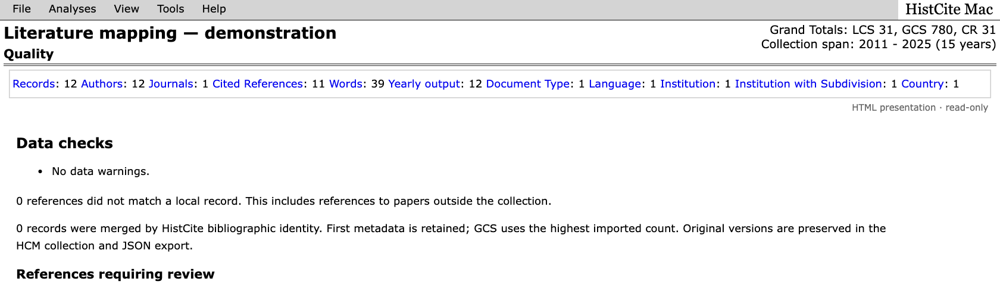
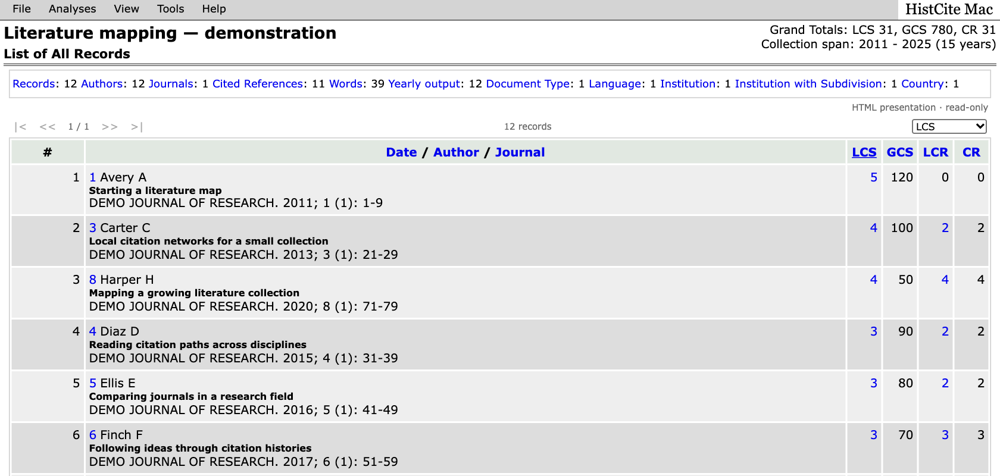
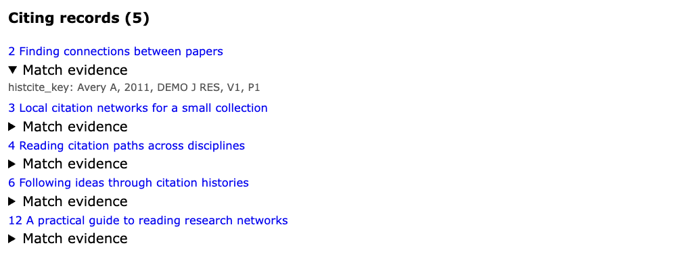
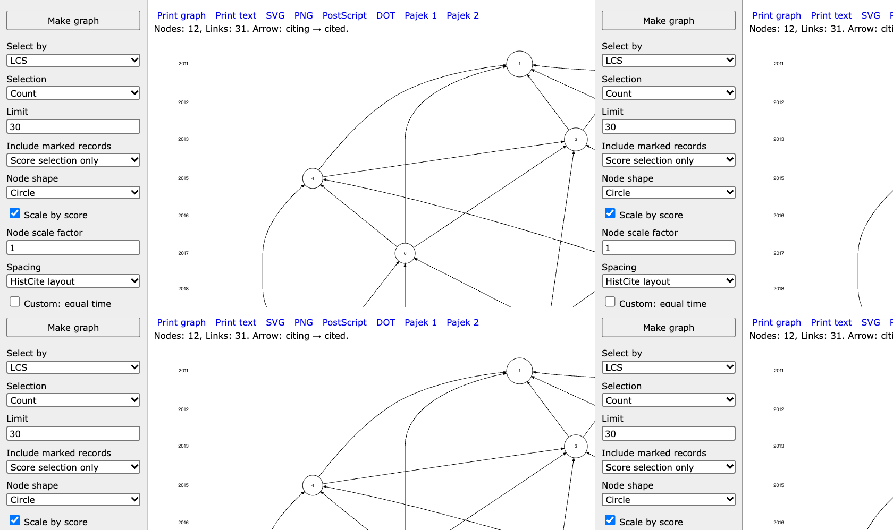

# 使用 HistCite Mac 追查文獻引用與繪製引文圖

[English](https://github.com/yangcc-lab/histcite-mac/blob/main/docs/citation-analysis.md)

當研究者從 Web of Science（WoS）蒐集大量文獻後，除了逐篇閱讀，也需要辨認哪些研究被反覆引用，以及不同時期的研究如何相互連結。HistCite Mac 可透過引用指標、引用來源查核及引文圖，協助研究者從大量書目中找到閱讀線索，進一步追查研究之間的關係。

以下以 HistCite Mac v0.3.5 的英文選單為例，介紹文獻匯入、引用分析與引文圖製作的操作流程。

操作畫面取自 HistCite Mac 的 HTML 檢視，使用隨附的公開練習檔。

## 一、匯入文獻並檢查資料

1. 在 WoS 檢索結果頁選擇 **Export → Plain Text File**，紀錄內容選擇 **Full Record and Cited References**，並保留原始 `.txt` 檔及檢索條件。
2. 依照 [Mac 安裝說明](https://github.com/yangcc-lab/histcite-mac/blob/main/README.zh-TW.md#1-下載並安裝)安裝程式，選擇 **File → Open collection…**，匯入一個或多個 WoS 檔案。
3. 開啟 **Tools → Data checks**，確認參考文獻缺漏情形與重複紀錄合併結果。

資料檢查會影響後續引用分析的可靠性。HistCite Mac 必須從參考文獻清單辨識引用對象，才能建立集合內的引用連線。因此，研究者應先確認資料完整性，避免將無法辨識的引用關係誤判為沒有引用。

## 二、比較 LCS 與 GCS，尋找值得閱讀的研究

匯入文獻後，點選 **LCS** 欄位排序，即可觀察哪些研究在目前集合中被較多文章引用。

- **LCS（Local Citation Score）** 計算目前文獻集合中引用某篇研究的不同文獻數量。例如 LCS 為 8，表示集合中有 8 篇文獻引用該研究。
- **GCS（Global Citation Score）** 是 WoS 匯出時提供的被引用次數，匯入後不會自動更新。

兩項指標提供不同的閱讀線索。例如，一篇文獻的 GCS 較高，但 LCS 較低，研究者便可進一步檢查它與目前研究主題的關係。若 LCS 較高，則值得追查集合內哪些文章引用了它。

引用次數受到檢索範圍、文獻納入條件及資料完整性影響。**研究者可據此安排閱讀順序，再透過原文判斷文獻的實際貢獻。**

## 三、追查引用來源與比對證據

LCS 能顯示文獻被引用的次數，卻無法直接說明引用來自哪些文章。研究者可依下列步驟追查。

1. 點選文獻標題旁的編號，開啟文獻詳情。
2. 在 **Citing records** 查看引用該研究的文章。
3. 展開 **Match evidence**，核對參考文獻原文與比對方式。

HistCite Mac 會將參考文獻與集合內書目進行比對。預設的 Histcite 模式主要使用第一作者姓氏、名字首字母、出版年份、卷號及起始頁建立比對鍵。當參考文獻符合唯一紀錄時，程式便建立引用連線。若符合多筆紀錄，則保留歧義供檢查。

**Match evidence 讓研究者從引用次數進一步追溯至具體的引用紀錄。** 若所有 LCS 都是 0，也可先透過 Data checks 確認資料是否缺漏，再判斷集合內是否確實缺乏直接引用。

## 四、繪製引文圖，觀察研究之間的關係

選擇 **Tools → Graph Maker…**，即可將文獻與引用關係繪製成圖。圖中的文獻依出版年份排列，將游標移至節點可查看資訊，點選節點則可開啟文獻詳情。

相較於 LCS 呈現引用次數，引文圖保留了引用者、被引文獻與出版時間之間的關係。例如，當一篇早期研究被多篇後續文章引用時，研究者可從圖中辨認引用者，再回到原文分析後續研究如何使用、延伸或修正先前的成果。

**引文圖提供的是可追查的引用結構，研究之間的思想關係仍須透過原文確認。**

圖形視窗支援 **SVG** 匯出。若用於研究報告，建議保留 WoS 原始檔，並記錄檢索條件、資料日期、App 版本及圖形篩選設定，以便重新檢查分析結果。

## 五、資料驗證與使用限制

2026 年 11 月 16 日，HistCite Mac 使用兩份未經外部清洗的 WoS 原始匯出檔進行驗證，共讀入 **1,217 筆文獻及 62,116 筆參考文獻條目**，並在預設 Histcite 模式下建立 **954 條集合內引用連線**，未出現歧義比對結果。

該次測試透過 CLI 與共用 Rust 分析核心完成，原生 Mac App 另有獨立測試。目前讀取器要求 UTF-8 文字及有效的 WoS 欄位結構，驗證結果僅適用於已測試的資料與條件。

研究者應區分資料匯入、引用比對及研究解釋三個層次。前兩者涉及資料與程式功能，後者則需要結合檢索條件與文獻內容，才能判斷引用關係的學術意義。

詳細說明可參考[相容性與驗證紀錄](https://github.com/yangcc-lab/histcite-mac/blob/main/docs/compatibility.md)及[引用比對方式](https://github.com/yangcc-lab/histcite-mac/blob/main/docs/citation-matching.md#繁體中文)。

## 延伸閱讀

- Eugene Garfield（2004），[Historiographic Mapping of Knowledge Domains Literature](https://journals.sagepub.com/doi/10.1177/0165551504042802)。
- 賓州大學典藏的 [Papers on Algorithmic Historiography](https://garfield.library.upenn.edu/algorithmichistoriographyhistcite.html)。

HistCite Mac 是由 `yangcc-lab` 開發的非官方獨立實作，參照 Eugene Garfield 與合作團隊開發的原版 HistCite 工作流程。
