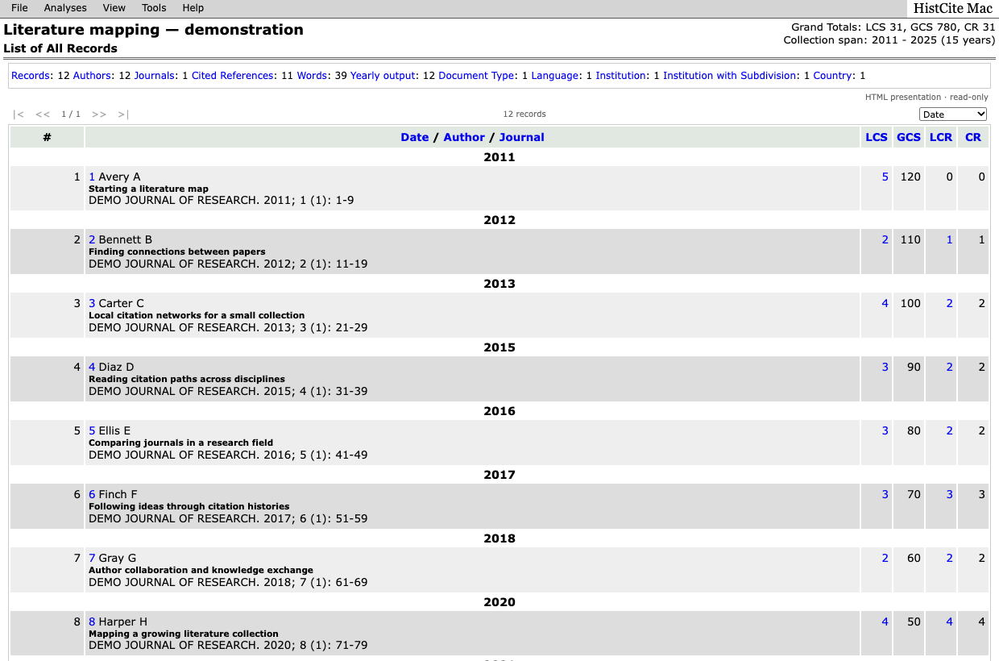
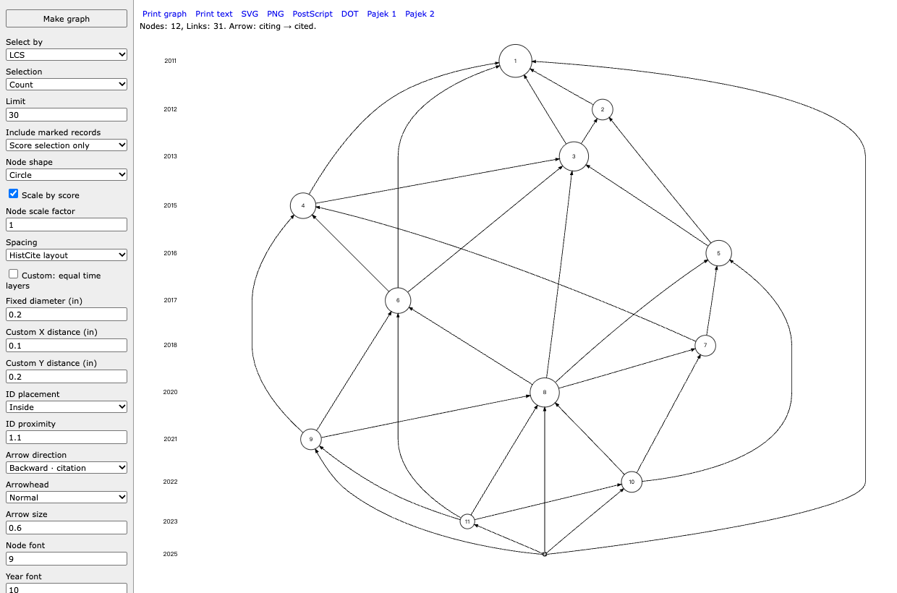

# HistCite Mac 下载与安装

**HistCite Mac 可以直接在 macOS 上分析 Web of Science 文献、查看 LCS/GCS 引用指标，并用 Graph Maker 绘制引文关系图。** 软件免费开源，支持 macOS 13 Ventura 及以上版本，Apple Silicon 和 Intel Mac 使用同一份 Universal DMG。

[下载最新 Mac 版本](https://github.com/yangnim21029/histcite-mac/releases/latest) · [繁體中文完整说明](../README.zh-TW.md) · [English](../README.md)

## HistCite 有 Mac 版吗？

现在有独立开发的 **HistCite Mac**。它用 Rust 实现分析核心，参照 HistCite 12.03.17 的主要操作流程，无需安装 Windows、Wine、CrossOver 或虚拟机，也不需要编程环境。

旧教程所说的 Windows 平台限制，可能指原版 HistCite 或使用原版程序的 HistCite Pro。HistCite Mac 是另一个独立项目，不包含原版 HistCite 程序代码或可执行文件，与原作者没有隶属关系。

## 下载安装

1. 打开[项目发布页](https://github.com/yangnim21029/histcite-mac/releases/latest)，在 **Assets** 中下载文件名以 `universal.dmg` 结尾的安装包。`Source code` 是源代码，不是安装包。
2. 打开 DMG，将 **HistCite Mac** 拖进 **Applications（应用程序）**文件夹，再从应用程序打开。
3. 当前社区发行版尚未经过 Apple 公证。如果 macOS 阻止打开，请先确认文件来自本项目的发布页，再按 [Apple 的说明](https://support.apple.com/zh-cn/102445)，在 **系统设置 → 隐私与安全性 → 仍要打开（Open Anyway）**中为这个 App 建立例外。这不表示 Apple 已验证其安全性。

## 导入文献并绘图

从 Web of Science 导出文献时，选择 **Plain Text（纯文本）**和 **Full Record and Cited References（全记录与引用的参考文献）**，保留原始导出文件与检索条件。

打开 App，选择 **File → Open collection…**，载入导出的 `.txt` 文件；分批导出的文件可以一起选择。点击 **LCS** 查看文献在当前集合内的被引次数，再通过 **Tools → Graph Maker…** 绘制引用关系图。**GCS** 是 WoS 导出时记录的被引次数，导入后不会自动更新。

安装包附有 `demo-wos.txt`，包含 12 篇虚构文献。可以先把它复制到 Mac 并导入，熟悉操作后再使用自己的研究数据。

## 保存与格式支持

选择 **File → Save as…**，使用 `.hcm` 保存工作集合。软件也支持读取 `.hci`，以及导出 CSV、离线 HTML 和 SVG、PNG 等图形格式。文献导入、整理与分析在本机完成；主动点击 DOI 或 WoS 链接时，会在浏览器打开对应网站。

原生 Scopus 导出文件和一般 Excel 文件需要先转换为兼容的 WoS 标签式格式，直接改扩展名无法转换数据。软件已针对特定数据和操作序列与原版进行比较，测试范围见[兼容性说明](compatibility.md)，不能据此推断所有输入和功能都与原版完全一致。

遇到问题可在 [GitHub Issues](https://github.com/yangnim21029/histcite-mac/issues) 提供系统版本、App 版本、操作步骤与不含私人研究资料的最小示例。
